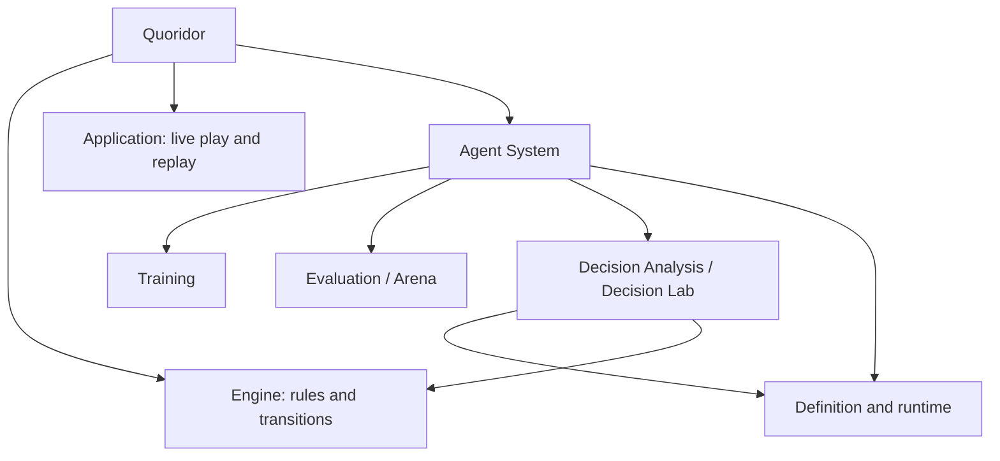

# Quoridor Decision Analysis

Author: Ji Hua / Codex
Created Date: 2026-10-20
Last Modified: 2026-10-20
Current Version: 3

Document Type: Design
Document Subtype: Agent Analysis Component
Document Status: In Development
Document Authority Scope: Agent System / Decision Analysis
Document Purpose:
Define the independent developer component for inspecting agent decisions,
including its system ownership, responsibilities, and diagnostic data boundaries.

---

## 1. Position in Quoridor

Decision Analysis belongs to Quoridor's Agent System, alongside Training and
Evaluation/Arena. **Decision Lab** is its independently launched developer interface.
It is part of the same system and repository. It owns neither gameplay orchestration
nor the evaluation tournament, and needs neither to be running.

The analysis unit is **one position + one configured agent decision**.
The developer may edit the position, inspect candidates, explore a hypothetical
continuation, compare algorithms/depths, and export a reproducible case.

## 2. Ownership and boundaries

| Concern | Owner |
|---|---|
| Agent identity and parameters | canonical Agent Spec |
| Scoring, search order, and tie behavior | existing agent implementation |
| Legal actions, walls, jumps, transitions, and winners | Rust Engine |
| Diagnostic capture, bounds, comparisons, and case export | Decision Analysis |
| Board rendering, selection, and previews | Decision Lab interface |
| Win rates, paired comparisons, Elo, and tournament execution | Evaluation / Arena |
| Weights, learning, optimizer state, and checkpoints | Training / model management |

Diagnostic state is isolated from live games, training runs, and tournament results.
Advancing a candidate changes only the developer's input position.
The frontend does not implement game legality or infer a search trace from an agent's
final move. It visualizes evidence returned by the actual scoring/search code.

Edited positions must satisfy geometry, inventory, and path-preservation validation.
This does not claim that every edited position has a known legal game history.

## 3. Supported algorithms

**Greedy:** show each legal action, own/opponent distance before and after it,
the actual heuristic score, tie-breaking order, and the resulting
position. Display the current algorithm faithfully, including its absence of a
special terminal-win score.

**Minimax:** show actual root search results, search depth in half-moves, root
player perspective, the two players' choices, search windows, cutoffs, and the principal
variation. Distinguish exact values from upper/lower bounds. Re-search a selected
candidate with a full window to inspect its exact depth-limited value.

Shortest-path overlays explain the wall-based distance heuristic. The heuristic
ignores the opponent pawn; overlays are not promised legal pawn-move plans.

**DQN (CNN/MLP):** select a checksum-pinned checkpoint from the existing model-management
catalog and reuse the shared runtime loader, network, and encoder. Inspect actual input
features, all action Q values and legality masks, layer activations, weight distributions
and slices, and local input gradients of a selected action or a Q difference.
Keep raw network outputs distinct from rule diagnostics and from estimates of playing strength.

Network observations retain their original semantics: spatial encodings are not flipped,
and legacy MLP inputs do not acquire a goal-direction feature through the diagnostic tool.
Intermediate vectors and weight matrices must not be presented as board coordinates.
Gradients are local sensitivity measurements under continuous relaxation of discrete inputs;
they do not establish causal explanations or legal counterfactual positions.

Model management owns checkpoint registration and identity. This component reads its
catalog and optional registry metadata, verifies hashes through the serving loader,
and does not promote models or scan mutable training artifacts. CPU diagnostic execution,
bounded model caches, tensor slices, and serialized per-model observation keep analysis
isolated from training and avoid concurrent observer interference.

The component supports deterministic Top1 only. Stochastic policies and MCTS remain
future extensions. DQN selection preserves the serving action-index tie order.

## 4. Developer workflow and diagnostic data

The interface is a working diagnostic tool. It opens directly to agent configuration,
position input, and analysis results. Inputs and measurements take precedence over
introductory copy, guided examples, or narrative presentation.

The developer supplies an agent configuration and a position, then inspects:

- the original position, root player, and actual Agent Spec;
- chosen and alternative actions, with engine order retained for tie diagnostics;
- evaluation terms, distances, score bounds, and terminal handling;
- branch search values, principal variation, search windows, cutoffs, and timing;
- neural input/output tensors, selected-layer diagnostics, checkpoint identity, and local sensitivity;
- source and Engine fingerprints, with any trace truncation stated.

Board overlays, candidate tables, and the search tree are coordinated views of the
same analysis. A data inspector exposes individual raw objects or the complete record
as JSON for inspection, copying, or export. It captures a snapshot when opened so
asynchronous calculations do not change data during inspection. Presets are optional
test inputs; JSON import and board editing support arbitrary validated positions.

Per-position diagnostics do not measure overall playing strength. Aggregate win
rates and ranking remain the responsibility of Arena.

## 5. Related documents

- [System architecture](../../system/design/system-architecture.md)
- [Agent System architecture](../../system/design/agent-system-design.md)
- [API and trace contract](decision-analysis-interface.md)
- [Component usage and deployment](../../../decision-lab/README.md)

## Changelog

Version 3 (2026-10-20)
- Added CNN/MLP diagnostics through shared inference and the existing model catalog.
- Defined tensor-coordinate, local-sensitivity, and model-ownership boundaries.

Version 2 (2026-10-20)
- Defined the developer workbench workflow and direct access to diagnostic objects.
- Removed narrative presentation from the component's interface requirements.

Version 1 (2026-10-20)
- Established the independent analysis component and initial Greedy/Minimax scope.
