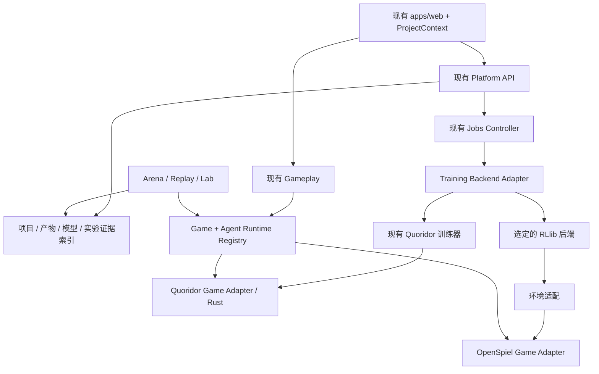

# Quoridor RL Arena 多游戏、多研究项目平台设计

日期：2026-11-02。状态：设计提案，未实施、未部署。

## 1. 结论与范围

在已经完成统一入口的 Quoridor 平台上，增加游戏适配、研究项目作用域和训练后端适配。保留现有 Web、Jobs、Arena、MLflow、模型校验、晋升审计与发布体系。Quoridor 为首个兼容游戏，Mr. Jack 为第二个目标游戏；先用一个小型现成不完全信息游戏验证接口。

本期目标是双人、顺序决策、零和博弈，包括隐藏信息和随机事件。暂不承诺任意多人、实时或同时行动游戏，也不建设插件市场、集群调度、通用图形编辑器。第三方库负责成熟通用能力，我们负责游戏语义、研究协议、信息隔离及适配。

本设计不把新增规则强制限定为 Rust。现有 Quoridor 继续只使用 Rust 引擎；新增游戏可使用 OpenSpiel 等规则实现。后续正式设计应把“Rust 是规则权威”扩展为“每种游戏只有一个权威规则实现”，不得在 Python/前端复制 Quoridor 规则。

## 2. 本次核查与版本边界

通过 SSH 只读检查 training（192.168.68.88）。未修改远端文件、服务、数据库、模型、分支或阵容；未运行训练、比赛、模型加载或测试。仅执行文件/源码读取、Git 状态读取、容器元数据检查和一个 health GET。没有读取令牌内容，没有 SSH 核查 Dev。

| 对象 | 本次观察 |
|---|---|
| 原始研究工作树 | `/home/jihua/workspace/boardgame-ai-arena`，`codex/environment-deployment`，`9737338af0abc67e59193b2c9747624e9fe9e513`；存在既存修改和产物，未触碰 |
| 旧统一仪表盘工作树 | `/home/jihua/workspace/boardgame-ai-arena-unified-dashboard`，`a8fc58d5217de34d380b1a3fce9dab18c6be2ddc` |
| 设计主基线 R | `/home/jihua/worktrees/quoridor/unified-rl-platform`，`feature/unified-rl-platform`，`772e88f`；检查时工作树干净 |
| 当前 Training 平台容器 | image ID `sha256:5178580be9185818bde4378ca4c1e592d77e4a15bdf8b5a1f008843df425f0eb`；revision 标签 `c0a56af` |
| 当前 Training Lab 容器 | image ID `sha256:5746cf19c0c0eb126759cfe24a77d60953bdf6d4d64fa3c06409db5055a4ee7f`；revision 标签 `fae4fa19837634f68a592c2a36cf121c4e6bb4e2` |
| 当前 Training 网关容器 | image ID `sha256:631ab2542287e4f2ec833fddd2f7ddc245048560a6b0cd1f211b05a3048f9404`；revision 标签 `c0a56af` |
| Jobs 控制器 | `quoridor-jobs.service` 为 active/running，unit 描述源码版本 `6e84213`；未对运行进程源码逐文件校验 |
| Training API | `http://192.168.68.88:8792/health` 返回正常、证据读取服务 `read_only:true`；不代表所有写服务或推理已验证 |

当前 README 与 `deploy/RELEASE.md` 记载：Dev 8790 为统一入口，Dev 运行 Gameplay，Training 运行 API/Lab/Jobs/MLflow。Training 容器及重定向端口与该记录相符；Dev 部分本次没有重新验证。

重要修正：本地 `source/` 与 ENVIRONMENT.md 是旧记录，不是当前完整基线。P0–P8 的统一入口、Jobs、持久化对战、模型索引和晋升已经有实现。本方案不会重复规划这些为从零开发。部分文档仍有旧状态标题或历史表格；以当前源码、最新 release 文档与本次观察分层判断，不把 HEAD 等同于所有运行服务版本。

## 3. 代码依据与真正需要改造的部分

以下路径相对主基线 R，可在所记录提交复查。

| 模块与证据 | 已有能力 | 多游戏改造 |
|---|---|---|
| `apps/web/src/views/AgentWorkspace.tsx` | 统一导航、训练/实验/Jobs/天梯/模型/Lab/Play | 加项目上下文；season 当前是全局选择，Play 还依赖赛季 roster；不能让新游戏在没有赛季时无法开局 |
| `apps/jobs/controller.py:50,83,157` | 单 GPU、有限 CPU 并发、固定 commit 快照、容器资源限制、取消与重启对账 | 当前一个 image、静态 ENTRYPOINTS；增加按后端版本批准的执行配置，不再把所有算法塞进 CNN 入口 |
| `agent_system/training/jobs.py:27,74,81` | 训练/诊断/评测入口与 manifest | 入口和对手是 Quoridor 特定的；仅 glob `.pt`、torch.load；语义用算法字符串推断。增加显式产物格式和输出语义 |
| `apps/jobs/store.py:11` | SQLite Jobs，有 experiment 字段 | 无 project/game 作用域；新增显式归属及版本化规格 |
| `training-dashboard/backend/experiments.py` | 外部目录发现、按来源关联模型、研究报告展示 | 当前 experiment 是目录 slug，没有持久 Project；新项目使用 manifest，旧目录继续只读适配 |
| `agent_system/definition/agent_spec.py` | 算法、策略参数与语义定义 | 缺少游戏、规则版本、角色、编码与推理后端合同；新增 v2 而非改变历史 hash |
| `agent_system/evaluation/arena/matrix.py` | 固定开局、交换席位、原子比赛块、统计 | 直接 import Quoridor 引擎、pawn/wall 编码、一步制胜探针和循环判断；拆比赛驱动与 Quoridor 协议 |
| `training-dashboard/backend/agent_arena.py` | 校验赛季 manifest、读取 roster/排名 | playable 用 dqn/greedy/minimax/random 白名单判断；改为运行时能力注册与兼容验证 |
| `apps/gameplay/games.py:27,98,119,131` | revision 控制、模型 SHA 校验、缓存与游戏恢复 | CreateGame 固定 p1/p2/season；从标准初态只按动作重放；player/watch 两类令牌，无法区分双方私有视角 |
| `apps/gameplay/store.py:9,47` | SQLite 游戏持久化、revision 条件更新 | 添加 game/rules/initialization、私有事件、角色绑定；保持事务原子性 |
| `apps/jobs/model_store.py`、`platform_models.py` | 模型校验账本、合并索引、来源证据 | `.pt` 单文件假设；支持多文件 bundle、框架元数据、游戏兼容描述 |
| `apps/jobs/promotions.py` | 人工决定、门槛证据、追加审计 | 当前以 SHA 为晋升键；扩展为具体游戏/规则/角色/AgentSpec 的部署资格 |
| `platform_context.py:122`、`agent_system/analysis/state.py` | 精确 replay→position→Lab 与 Quoridor 校验 | 增加视角/历史/信息状态，不能将完整状态传给普通策略分析 |
| `packages/board-ui/src/RecordedBoard.tsx` | 已抽出的 Quoridor 棋盘 | 保留为 Quoridor renderer；不是通用棋盘模型 |
| `scripts/sync_gameplay_mirror.sh` | Training→Dev 证据镜像，排除 games/MLflow/Job 快照 | 对隐藏信息产物增加显式同步清单；不自动把新增私人研究轨迹暴露到浏览端 |

## 4. 领域模型与身份

### 4.1 项目不是游戏，也不是实验

`GameDefinition` 描述规则及能力；`Project` 描述长期研究目标，首期绑定一个游戏/规则版本；`Experiment` 描述一个问题和若干 arm；`Job` 是一次计算；`Run` 是训练或评估证据；`Season` 是按固定协议完成的一批对战。

示例：Project `mrjack-information-learning` → Experiment `memory-ablation-001` → arms `explicit-knowledge` / `recurrent` → 各自多个 seeds 与 Jobs。

首期跨游戏研究通过比较报告关联多个项目完成，不在一个 Project 内混装不兼容游戏。一个产物可被多个项目引用，但原始来源不变。项目作用域不是多租户安全边界；首期仍沿用可信局域网与既有写令牌。

### 4.2 新对象最小字段

| 对象 | 新合同关键字段 |
|---|---|
| GameDefinition | game_id、ruleset_id/version、实现版本、角色、decision/chance 能力、schema 版本 |
| Project | project_id、标题、问题、game_ref、默认协议引用、创建时间 |
| AgentSpec v2 | game_ref、supported_roles、runtime_backend/version、model_ref、encoder_ref、action_schema、output_semantics、算法/搜索参数、memory_mode |
| JobSpec v2 | project_ref、experiment_ref、game_ref、backend/profile、entrypoint/version、源码 commit、镜像 digest、配置 hash、输入 manifest、随机种子、资源、后处理 |
| EvaluationProtocol | game/rules、角色安排、对手及 AgentSpec hash、场景分布/种子、终止与截断规则、指标版本、预算、开发/测试用途 |
| ModelBundle | 格式、文件清单及每文件 SHA、bundle digest、推理入口版本、输入输出 schema、来源 Job/Run；训练恢复状态另列 |
| ReplayManifest | 游戏/规则/实现版本、初态引用、事件格式、参与者身份、随机事件证据、可见性策略、结果与完整性 hash |

模型字节 hash 与 Agent 行为 hash 分开。同一模型使用不同角色编码、搜索预算或采样策略属于不同 AgentSpec。项目归属不进入行为 hash，运行 seed 记录在实例/比赛中。规则版本、动作/观测编码和推理实现版本进入兼容身份。

游戏结果采用按角色的 returns 与 winner_roles；结束原因保留 engine_terminal、protocol_draw、truncated、illegal_action、agent_error。技术失败不是游戏本身的负奖励定义，协议需说明是否判负，并同时独立计数。

## 5. 模块设计

先定义边界、注入适配器，不立即搬迁目录。新增建议：`agent_system/games/{contracts,registry,quoridor,openspiel}/`、`agent_system/training/backends/`、`agent_system/runtime/backends/`；共享 wire schema 放 `packages/contracts/`，前端游戏组件放 `apps/web/src/games/`。文件只在实际有实现时新增。

### 5.1 Game Adapter

核心接口概念：`initialize(config, rng)`、`next_actor(state)`、`observe(state, role, history)`、`legal_actions(state, role)`、`apply_action(state, action)`、`resolve_chance(state, rng)`、`outcome(state)`、`serialize/restore`、`project_view(state, viewer)`。

`next_actor` 可以是某个角色、chance 或 terminal；不通过 player 编号交替推算。自动结算不能被当作训练决策。完整状态只交给可信引擎/重放器；普通 AgentRuntime 接收 DecisionRequest：角色观测、合法动作、阶段、受控历史和决策序号，不接收 raw state 或全局随机种子。

动作分两层：引擎的有类型动作表示，与某个训练后端使用的固定 Discrete ID/mask。编码器负责映射并版本化；不让前端或平台数据库强制要求 209 输出。首期 PPO 使用按阶段固定空间及 mask，避免一开始泛化到任意变长模型。

可选能力：clone、搜索、信息状态编码、renderer、神经诊断。能力不支持时返回具体原因，不隐式替换算法。循环/重复判和是游戏或评测协议特性，不能作为全平台默认行为。

### 5.2 Agent Runtime

`create(spec)` → `reset(episode_context)` → `act(decision_request)` → `observe(events)` → `close()`。缓存模型权重与单局实例分开，单局随机数和 RNN 隐状态不能共享。

重启恢复策略必须声明：无状态 agent 可直接重建；记忆 agent 通过所属玩家的完整可见历史重建，或恢复版本化的隐状态与 RNG 快照。无法精确恢复时暂停并报错，不把“重新创建实例”宣传为相同策略续局。

搜索 agent 经专用模拟接口获取与自身信息一致的假设状态。完整真值不能因实现方便泄漏到普通搜索；Quoridor 完全信息搜索可以保留原路径。

### 5.3 Training Backend

复用 Jobs 的队列、取消、资源限制、源码导出和重启对账，只新增 `TrainingBackend` 插件及受批准 `ExecutionProfile`。一个 profile 固定镜像 digest、后端版本、允许的入口、配置 schema、输入合同与导出格式。不要接受浏览器传任意 image 或 shell command。

Controller 与 Job 快照的入口版本要一致：提交时校验源码快照的 manifest 与已批准 profile，记录解析结果，执行时再核验。当前“控制器 ENTRYPOINTS + 任意已解析 commit”模式在接多后端时需明确兼容边界。

第一种后端是 `quoridor_legacy`，薄包装现有训练器，不改 PPO/DDQN 数学语义。第二种候选是 `rllib`；只有小型游戏契约验证通过后才锁定依赖版本。为节省维护成本首期不同时接 SB3、TorchRL、JAX 等多套训练器。

标准输出包括 events、显式指标元数据、model bundle、回放引用和训练恢复说明。指标需标注 step_axis（env decision / learner update / episode / wall time）、单位与角色，避免不同库都叫 step 却被错误叠图。取消后的部分产物可以登记，但必须标 interrupted，不自动作为完整评测候选。

### 5.4 Arena、晋升与研究协议

从 `matrix.py` 抽出通用 MatchRunner；Quoridor 的开局生成、对称变换、循环规则、一步制胜探针留在对应插件。旧 runner 可先保留，作为回归 oracle。

通用 runner 按 next_actor 驱动、处理 chance、收集分角色 returns 与事件。固定 scenario_id、environment_seed、每个 agent 的 seed；随机事件按环境独立 RNG 管理，防止推理调用数量改变发牌。交换角色的配对比赛使用同一个底层场景，统计单位为场景组而非孤立单局。

Mr. Jack 分角色报告，不默认棋力对称；不同游戏和不同协议不合并 Elo。完整游戏优先对手池评估，精确 exploitability 仅在规模可行时使用；近似最佳响应不得标成精确 exploitability。

晋升键从裸 checkpoint SHA 扩展为 game/rules/role/deployment_target/AgentSpec hash；引用具体协议和 gate evidence。当前 Promotions 证明候选参与了完整门槛批次且人作出决定，不应把它改称已经满足自动统计强度门槛。旧日志不重写，读取时保留 legacy 意义。

### 5.5 模型与数据存储

现有 `/home/jihua/quoridor-data` 物理路径先保留。新增 projects 索引与 bundle manifest，避免在功能迁移中改整个数据根。新多文件模型存入独立 immutable bundles 区，目录内容以规范化 manifest digest 定义身份，逐文件校验；旧 `models/<sha>.pt` 地址保持有效。

ModelIndex 继续合并来源证据，但格式解析交给 provider；未知架构不自动标 playable。registration、分析资格、可推理资格、已评测、人工批准和实际服务加载应分别显示，尤其不能用 promotion 日志直接证明进程已加载。

Project 元数据由唯一写服务管理，首期可放 Jobs 侧管理 API/SQLite；Research API 继续只读。历史实验通过显式绑定表归入 Quoridor 项目；不能仅因目录名字含 cnn 就推断来源。新任务显式记录 project_ref，不从 UI 当前筛选推断。

### 5.6 隐藏信息：对战、回放和 Lab

当前整局 player token 不足以服务双方隐藏信息。新游戏绑定 role-scoped tokens；watcher 只收到公开投影。旧 Quoridor token 只对旧协议继续有效，不允许升级后自动获得 Mr. Jack 两侧权限。

Replay v2 保存初始化与有序事件：玩家动作、随机结果、自动结算、私人信息事件。规则版本、初始随机记录与事件使重放稳定；仅存 seed 不足以保证跨规则/库版本可重放。服务内部可保存真值；玩家/观战 API 由服务端投影并过滤事件、状态、错误、mask、下载产物与日志。

禁止将 live 完整初态/seed/牌堆或可穷举秘密的 full-state hash 返回浏览器。玩家侧仅计算该视角 hash，必要的内部完整性引用使用不暴露秘密的 opaque ID。公共回放是否在终局揭示身份是显式策略；全知研究回放必须单独授权，不能只靠前端切换开关。

AnalysisContext v2 包含 game_ref、viewer/role、public/private/history refs、模型、规则版本、决策序号。缓存键包含视角与权限上下文；Mr. Jack 仅给当前棋盘不能复原合法的历史信息状态，因此缺少历史时显示“不完整上下文”，不假装重现原 agent 决策。

事务提交一次玩家决策及其自动/随机事件；revision 控制仍保留。对外 decision_index 与事件 event_index 分开，避免一个技能的多事件被误报成多次玩家决策。

### 5.7 前端

保留现有八个工作区，在外层增加 ProjectContext 与项目切换器，采用可深链的 `/projects/:projectId/...`。旧 URL 继续解析至 Quoridor legacy 项目；跨项目对象链接使用对象实际归属，不以当前选择强行重解释。

GameRendererRegistry 按 game_id 显示 Quoridor 棋盘或 Mr. Jack 棋盘；动作面板由阶段和动作 schema 驱动，前端不判断规则合法性。Lab 能力缺失时展示可用的动作/观测/回放，不要求所有后端都有 CNN 激活图。

Play 从合法 AgentSpec 列表创建，对 season 的依赖改为可选来源。这解决新游戏尚无排名就无法人工验收的问题。Project 过滤须贯穿 Jobs、实验、模型、赛季、诊断、promotion 和 API 服务端校验，不能只过滤导航。

## 6. 第三方复用决策

| 能力 | 提案 | 尚需验证 |
|---|---|---|
| 游戏形式化 | OpenSpiel；Quoridor 保留原引擎 | 自定义 Mr. Jack 规则来源、信息集/随机节点/序列化合同 |
| RL 环境接口 | 优先一个薄的 OpenSpiel→训练后端适配；有需要再用 Shimmy/PettingZoo AEC | 非交替行动、mask、终局回报及历史能否完整传递；避免叠多层 wrapper |
| 神经训练 | RLlib 候选，现有训练器保留 | 小型顺序博弈上 mask + 两角色策略 + 导出/恢复；如使用记忆，额外验证序列与 hidden state |
| 搜索/博弈基线 | OpenSpiel 提供的适用算法 | 每个算法所需接口及成本；不可把完全信息 PUCT 直接当隐藏信息搜索 |
| Mr. Jack 实现 | Aghajari/Mr.Jack 作为审查候选 | 无界面运行、规则一致性、状态复制、私有信息、吞吐、许可文件与所用资产；尚未运行或批准采用 |
| 研究平台 | 复用已有 Jobs/Arena/MLflow/Web/发布工具 | 扩展合同，不重新造平台 |

资料（本对话前一轮已经检索，非本轮安装验证）：
- OpenSpiel： https://github.com/google-deepmind/open_spiel
- 算法： https://openspiel.readthedocs.io/en/latest/algorithms.html
- RLlib： https://docs.ray.io/en/latest/rllib/multi-agent-envs.html
- Shimmy： https://shimmy.farama.org/environments/open_spiel/
- PettingZoo AEC： https://github.com/Farama-Foundation/PettingZoo/blob/main/docs/api/aec.md
- Mr. Jack 候选： https://github.com/Aghajari/Mr.Jack

不将第三方当前 latest 直接投入部署；实验锁定版本、依赖与镜像后记录选择理由。规则审查不通过时，可在 OpenSpiel 中实现 Mr. Jack 游戏，而不是为其重写整套训练平台。

## 7. 迁移、验收与回滚计划

| 阶段 | 修改范围 | 验收条件 | 回滚边界 |
|---|---|---|---|
| M0 合同与基线 | 新设计/任务记录、schema fixtures、发布版本清单；选小型验证游戏 | 确认 HEAD 与各服务来源；明确 legacy readers、项目映射及受保护产物 | 无运行时变化 |
| M1 Quoridor 插件切片 | Game/Runtime registry；先迁 Arena 对局驱动 | 同固定 state/action/RNG，旧新 runner 的合法动作、终局、逐步轨迹一致；神经误差按声明容差 | feature flag 回旧 runner，旧模型/协议 hash 不变 |
| M2 项目和身份 | Project API、JobSpec/AgentSpec v2、UI scope、历史映射 | 两项目同名实验不串；不兼容模型拒绝；旧路由/目录/manifest hash 不变 | 禁新项目入口，保留新增数据，旧项目可读 |
| M3 第三方训练切片 | 独立 profile + RLlib adapter + bundle reader | 现成 Kuhn Poker 等小型游戏完成两角色决策、训练、取消、重启对账、模型导出再加载、Arena 回放；不要求先达到强策略 | 关闭该 profile，不影响旧 GPU Job 与 `.pt` |
| M4 隐藏信息基础 | Replay v2、视角投影、role tokens、记忆恢复、Lab context v2 | 同信息集不同秘密的观测/mask一致；两席/观战隔离；恢复和缓存无跨视角泄漏；随机事件重放一致 | 阻止创建新 v2 局；v2 reader 保留；不可直接回到不识别新游戏的旧数据库写者 |
| M5 Mr. Jack | 审查/实现规则，编码与 renderer，随机/启发式 agent | 选定版规则案例、技能阶段、private alibi、随机牌、胜负及回放通过；端到端训练→评估→模型→对战 | 禁用 game definition，保留证据和既有 Quoridor 服务 |
| M6 研究协议与发布 | 固定对手/角色评估、探针、晋升作用域、镜像同步和跨机兼容 | 多 seed 先导研究；报告算法/计算预算；Dev/Training 合同匹配；旧 Quoridor 回归与隔离发布验收通过 | 按服务 release 回滚；不回滚抹掉新证据 |

M4 可在 M3 的接口验证后、与 M5 规则审查部分交错推进；Mr. Jack 完整训练必须等规则及信息隔离验收完成。每一步提交独立 PR/发布，不把文件大搬家和算法行为改变混在一起。

第一批具体工作包：
1. M0：`GameRef/ProjectRef/AgentSpecV2/ReplayManifestV2` 设计及兼容 fixture。
2. M1：`QuoridorAdapter` 包装现有引擎，通用 MatchRunner 双轨回归。
3. M2：Project 索引及端到端过滤；保留 legacy hash namespace。
4. M3：一个批准 profile、一种第三方后端、一个现成游戏的完整纵向切片。
5. M4：先服务端 role/view/event 隔离，再新增 UI 视角选择。
6. M5：Mr. Jack 源码审查记录决定复用或重写规则，之后开展专用环境实现。

### 数据兼容与回滚规则

- 旧 AgentSpec hash、赛季 manifest hash、checkpoint SHA 不重新计算。适配层外部附 legacy_quoridor scope，保留 original_ref；新对象使用 v2 namespace。
- 新 schema 缺少 game_ref 时拒绝；只有明确的 v1 reader 可以赋默认 Quoridor，防止把坏的新数据误解释为旧游戏。
- SQLite 使用显式 schema migration，先增加可空列/新表、备份和兼容 reader，再启用新 writer；不能靠 CREATE TABLE IF NOT EXISTS 完成已有数据库升级。
- 发布前明确旧服务能否安全读取新库。不能安全读取时保留兼容服务或暂停 v2 写入，不将恢复旧数据库备份作为默认回滚方式。
- 历史目录不批量搬迁、重命名或改写；新项目元数据通过映射连接。Dev evidence mirror 对新格式使用完成标志/manifest 最后发布，避免模型只同步一半即被列为可用。
- 当前一个控制器拥有 Job 数据根的约束继续保留；隔离测试使用独立数据库、端口、产物根和训练 profile。

## 8. 测试设计与研究验收分离

迁移测试：旧新 Quoridor 引擎结果、player 视角、mask、坐标、高位墙、模型语义和 replay→Lab 同局面；通用模块避免直接 import quoridor_engine，由适配模块例外允许。

多游戏契约：连续同角色决策、chance 后仍同角色、终局直接发放双方结果、训练截断 bootstrap、非法动作与 agent_error、不同规则版本拒绝、记忆 reset/恢复、角色交换。

隐藏信息性质：构造两个合法完整状态，玩家可见历史完全相同但秘密不同，比较其观测、动作 mask、事件、错误响应、view hash；Agent 输出分布在相同 agent RNG/记忆下应一致。私人事件仅到合法角色；研究者全知模式显式分开。

平台验收：跨项目同名资源、原始引用保留、bundle 校验失败、旧新模型并存、取消后的登记、重启对账、前后端深链、Dev 镜像滞后时显式 unavailable。测试不触发生产晋升。

功能验收不等于棋力验收。M3 冒烟验证的是算法适配及产物闭环；M6 才按预先固定协议报告学习效果。不同后端 wall time、决策数、梯度更新数分别记录，不能仅用相同 episodes 宣称等预算。

## 9. 设计取舍与后续确认

建议默认：继续单仓库、当前物理数据根、现有 Dev/Training 分工和一个 GPU 调度；首期每个 Project 一个游戏；Quoridor 兼容优先；只接一个外部训练后端；不为第三方后端重写内部优化器。

实施前需要固定的产品决定是 Mr. Jack 的具体规则版本，以及第一个研究问题是角色策略、记忆还是隐藏信息搜索。它们不阻塞 M0/M1 的平台设计。

最大工程风险依次是：隐藏信息通过回放/缓存/日志泄漏；现有 hash 与历史证据在迁移中改变；训练 profile 和源码/依赖不兼容；新 bundle 在 Dev 不可加载；游戏规则代码与 UI 强耦合导致复用成本高。先做小型环境的完整闭环，再决定 Mr. Jack 规则实现路线，能尽早暴露这些问题。

本提案交付在本地工作区，故意不提交到远端仓库；它是供讨论的设计，不是当前权威架构的已接受修订。本次未运行测试，以上验收均为后续计划。
