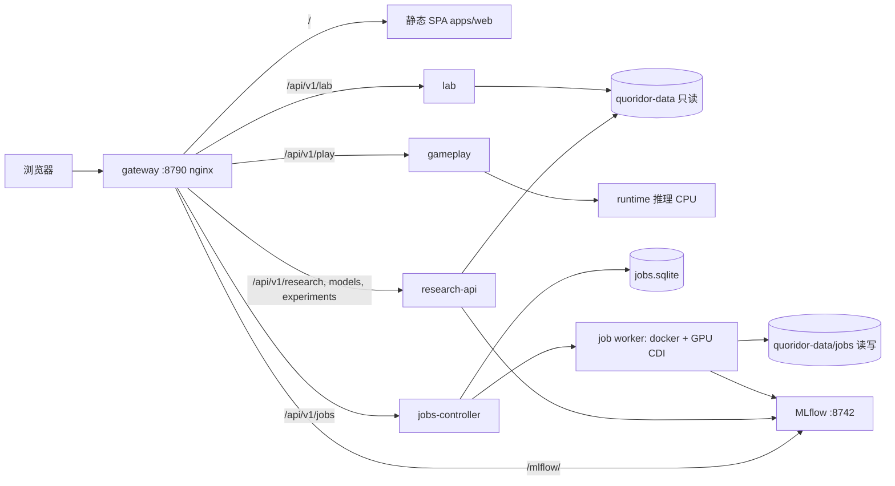

# Quoridor RL 统一平台：单入口训练、诊断、对战设计

Status: Proposed design, 2026-10-31. 尚未实现；实施状态记录在 `docs/tasks/20261031-unified-rl-platform.md`。
Authority: 在入口、信息架构、Jobs 与服务收敛问题上细化 [monorepo-deployment.md](monorepo-deployment.md)。
引擎规则权威、AgentSpec 语义、Q 值 / policy logits / state value / 搜索统计的语义区分保持不变。

## 0. 用户决定（2026-10-31）

1. 整个平台只有**一个入口**。以当前 Training 8790（`feature/agent-ladder-preview`）为起点。
2. **先在 Training 上设计和落地**，以后再把 Web/Gameplay 迁回 Dev。这一阶段暂时偏离 monorepo 设计中"Dev 跑 Web/Gameplay"的分工；迁移时以本文第 10 节为准。
3. 平台定位是**全方位的 RL 训练、诊断、对战平台**，不只是证据浏览或预览。
4. 第 12 节的待决问题按推荐方案执行（2026-10-31 确认）：
   - 唯一入口固定为 Training **8790**，P4 后 8741 与 8765 重定向到它。
   - Jobs 写操作使用**共享令牌**，暂不做登录。
   - 训练使用**新建的 CUDA GPU 镜像**，不以 host venv 进程作为正式方案。
   - MLflow 界面通过 **`/mlflow/` 反向代理**进入同一入口（需验证子路径静态资源）。
   - 历史 artifacts 先**复制并校验**到 `quoridor-data/legacy-artifacts/`，再解除对旧 worktree 的挂载。
   - Classic 对弈保留哪些功能（第 12 节第 5 条）仍待用户确认，P4 之前不影响实施。

## 1. 目标与非目标

### 目标

在一个网址里完成一条研究闭环：

```
提出研究问题 → 配置并提交训练 → 实时观察训练 → 自动产出 checkpoint
  → 诊断（探针 / 留出集 / 行为统计）→ 评测（Arena 赛季 / 天梯）
  → 对局回放与逐步分析 → 人机或机机对战验证 → 结论记录 / 晋升决定
```

所有页面共享同一套身份：Agent（AgentSpec hash）、Checkpoint（SHA-256）、Run、Job、Season、Game、Position。
任意页面都能跳到相关对象，而不是让用户拷贝 SHA 到另一个网站。

### 非目标（本设计不做）

- 不实现用户账号、TLS、公网访问；仍是可信局域网。只给有写操作的接口加共享令牌（见 9.2）。
- 不重写规则、不在 Python/TS 中重复实现合法性。
- 不修改历史证据、历史赛季报告、MLflow 数据库文件、已有 champion 别名或线上阵容。
- 不追求多机分布式训练；Training 只有一张 RTX 3080 Ti，调度按单 GPU 设计。

## 2. 现状摘要（2026-10-31 核查）

| 问题 | 事实 |
|---|---|
| 多个入口 | Training 8790（ladder 预览）、Training 8740/8741 与 Dev 8765（10-25 统一前端）、Training 8744（独立 Lab）、8742（MLflow）。 |
| 对弈 3 套 | Classic（Dev 8764 WebSocket → Training 8743）、research Play（`/play-api` → Dev 8776 → Training 8783）、8790 进程内 `/api/agents/play`。 |
| Lab 3 份 | systemd 8744、`quoridor-unified-lab-1`、`quoridor-agent-preview-lab-1`。 |
| Runtime 4 份 | Training 8743（systemd，旧 checkout）、8783、8790 Platform 进程内、Dev 8090。 |
| 两套前端外壳 | `AgentWorkspace`（8790 使用）和 `LegacyApp`（六工作区，已无路由可达）。 |
| 后端命名错位 | `training-dashboard/backend` 实际承担整个平台的 API。 |
| 训练没有平台化 | 实验由手写 JSON 配置 + 外部目录里的 `run-evaluation.py`、`launch/first-pids.json` 启动；UI 只能只读浏览，不能提交、取消、看实时日志。 |
| 数据目录分散 | 10 个 `catalog-*.json` 与 `registry.json`；Platform 仍挂载旧 dirty worktree 的 `agent_system/training/artifacts`。 |

## 3. 领域对象与身份

| 对象 | 身份 | 来源 | 说明 |
|---|---|---|---|
| Checkpoint | 文件 SHA-256 | `quoridor-data/models/<sha>.pt` | 只标识字节，不等于完整 Agent 行为。 |
| Agent | AgentSpec hash（算法 + policy + 参数 + 模型 SHA） | AgentSpec YAML / 赛季 manifest | 启发式 Agent 没有 checkpoint SHA，不得伪造。 |
| Run | `<source>:<id>`，source ∈ `legacy`、`mlflow`、`job` | 旧 artifacts、MLflow、Jobs | 来源命名空间不同，不做猜测式合并。 |
| Experiment | slug（如 `cnn-policy-rl-20261020`） | `quoridor-data/experiments/<slug>` | 一个研究问题，包含若干 arm/Run、协议、评测和结论。 |
| Job | `job-<UTC 时间>-<短随机>` | `quoridor-data/jobs/<id>` | 一次可调度的计算：训练、评测、诊断、数据生成。 |
| Season | 目录名 + manifest SHA | `quoridor-data/arena/<season>` | 不可变的评测报告；Elo 只在赛季内有效，赛季之间不合并。 |
| Game | 来源命名空间 + id | 赛季 gzip 块 / 训练评测回放 / Play 会话 | 回放统一经 Rust 重建校验。 |
| Position | 规范化局面 JSON + hash | 任意 Game 的某一步，或手工编辑 | Lab 的输入单位。 |
| ProbeSuite | 名称 + 版本 + SHA | `quoridor-data/probes/<name>/<ver>` | 版本化诊断局面集（立即获胜、必须防守、D2 留出集等）。 |

**模型能力状态**分开记录，互不推导：

`registered`（有 SHA 副本）→ `analyzable`（Lab 能加载）→ `playable`（能实例化成 Agent）→ `ranked`（出现在某赛季）→ `deployed`（线上阵容 / champion）。

## 4. 信息架构（单入口导航）

一级导航以 8790 现有界面为基础扩展：

| 导航 | 路由 | 内容 | 来源 |
|---|---|---|---|
| 总览 | `/` | GPU 与队列、运行中 Job、最近完成的 Run 与评测、最近实验结论、服务健康 | 新增 |
| 实验 | `/experiments`、`/experiments/:slug` | 研究问题、各 arm 配置与 Run、预先声明的协议、结果表、结论 | 新增；读取 `experiments/*` 中已有的 assessment/report |
| 训练 | `/training`、`/runs/:runRef`、`/runs/compare` | Run 列表、实时曲线、配置/来源、checkpoint、对比 | TrainingWorkspace + RunList/Compare/Metrics 合并 |
| 任务 | `/jobs`、`/jobs/new`、`/jobs/:id` | 提交训练/评测/诊断、队列、实时日志、取消、重跑 | 新增（第 6 节） |
| 天梯 | `/ladder`、`/agents/:id`、`/games/:id` | 赛季排名、Agent 详情、交手记录、回放、逐步分析 | 8790 现有 |
| 模型 | `/models`、`/checkpoints/:sha` | 按 SHA 的统一模型索引、能力状态、来源 Run、所在赛季、晋升记录 | ModelsView + CheckpointPage 合并 |
| 实验室 | `/lab` | 自由编辑局面、多 Agent 对比、搜索树、张量、敏感性、探针集浏览 | LabView 搬入；天梯/回放/对战里的分析复用同一组件 |
| 对战 | `/play` | 人机、机机（逐步 / 自动），观战，暂停到快照分析 | 8790 现有 |

链接规则：
- 所有对象标签（Agent、SHA、Run、Season、Game）都是可点击链接，并带语义标记（Q 值 / logits / 启发式分数）。
- 评测批次通过 `?season=` 保持上下文；Lab 通过 `?position=` 或 `?game=&ply=` 打开。

## 5. 系统架构（Training 单机阶段）



| 服务 | 来源目录（目标） | 职责 | 写权限 |
|---|---|---|---|
| gateway | `deploy/gateway.conf.template` | 唯一对外端口，按前缀路由 | 无 |
| web | `apps/web` | 单一 SPA | 无 |
| research-api | `training-dashboard/backend` → 逐步迁到 `apps/research_api` | Run、实验、赛季、模型索引、回放、证据读取 | 无（只读挂载） |
| jobs-controller | `apps/jobs`（新增） | Job 提交、队列、状态、日志流、取消、后处理链 | `quoridor-data/jobs`、`jobs.sqlite` |
| job worker | `apps/jobs` 同进程内调度器，按 Job 启动容器 | 在固定源码快照里跑训练/评测/诊断 | 仅本 Job 输出目录 |
| gameplay | `apps/gameplay`（从 `agent_arena.py` 的 play 部分拆出） | 对局会话、版本号校验、席位 | 会话库（P4 起） |
| runtime | `agent_system/runtime` | 按 AgentSpec 加载 Agent 并给出动作 | 无 |
| lab | `agent_system/analysis` | 局面分析，不修改任何对局 | 无 |
| MLflow | `model-management` | Tracking 与 Registry | 只有 MLflow 自己写数据库 |

**收敛目标**：Runtime、Lab、Gameplay 各只剩一份。旧的 8740/8741/8743/8744/8783 以及 Dev 8764/8765/8774/8776/8090，在第 11 节对应阶段通过验收后再下线，并保留回滚。

## 6. Jobs 子系统（新增，最关键）

### 6.1 Job 规格

```json
{
  "kind": "train | evaluate | arena | diagnose | collect",
  "experiment": "cnn-value-head-20261101",
  "arm": "A-baseline",
  "source": {"commit": "<完整 SHA>"},
  "entrypoint": "agent_system.training.jobs:train_policy_ppo",
  "config": { ...  按 entrypoint 的 JSON Schema 校验 ... },
  "resources": {"gpu": 1, "cpus": 6, "memory_gb": 16, "timeout_h": 12},
  "seed": 42,
  "after": ["job-..."],
  "on_success": ["register_checkpoints", "diagnose:standard-v1", "arena:gate-v1"]
}
```

- `source.commit` 必须是已经提交的完整 commit。controller 用 `git archive` 导出只读源码快照到 `jobs/<id>/source/`，记录 tree hash。不允许跑未提交的源码。
- `config` 按 entrypoint 声明的 JSON Schema 校验。UI 的表单从 Schema 生成，也支持"从已有 Run 复制配置"。
- 现有手写实验配置（`agent_system/training/configs/**`）作为模板列表。

### 6.2 状态机

```
queued → preparing（导出源码、校验输入 SHA）→ running → succeeded | failed | cancelled
                                               ↘ post-processing → succeeded
```

- 单 GPU 按 FIFO 调度，支持优先级。只占 CPU 的 Job（评测、诊断）可以与 GPU Job 并发，受总 CPU/内存上限约束。
- controller 重启后对账：读 `jobs.sqlite` 和 docker 容器状态；容器还在就继续跟踪，消失了标记为 `failed (lost)`，绝不静默重跑。
- 取消：先 SIGTERM，宽限期后 SIGKILL；已写出的 checkpoint 保留并标记为中断。

### 6.3 执行环境

- 每个 Job 一个容器：基于 research 镜像 + CUDA 版 PyTorch（GPU 镜像需新建，见第 12 节决策 3），通过 CDI `nvidia.com/gpu=0` 分配 GPU。
- 挂载：`jobs/<id>/source` 只读，`jobs/<id>/output` 读写，`quoridor-data` 其余部分只读（输入数据集、teacher、checkpoint）。
- 根文件系统只读，有资源上限，不开放网络（只允许访问 MLflow）。

### 6.4 输出契约（所有 entrypoint 统一）

```
jobs/<id>/
  job.json            # 提交时规格 + 解析后的配置 + 源码 commit/tree + 输入 SHA
  status.json         # 状态、时间、退出码、资源使用
  events.jsonl        # 结构化事件：progress、metric、checkpoint、eval、warning
  stdout.log          # 原始日志
  output/
    metrics.jsonl     # 沿用现有训练产物约定
    eval_results.jsonl
    checkpoints/*.pt
    manifest.json     # checkpoint 列表 + SHA + 语义（q_values / policy_logits / value）
```

- `events.jsonl` 是 UI 实时曲线和进度的唯一数据源；通过 SSE（`GET /api/v1/jobs/:id/events`）推送。
- MLflow 记录由 entrypoint 内的统一 logger 完成，Run 标签写 `job_id`、`experiment`、`arm`、`source_commit`。这样 Run 在 research-api 里以 `job:<id>` 和 `mlflow:<run_id>` 互相关联。

### 6.5 Entrypoint 收敛

现有训练代码已经较完整（`trainer.py`、`policy_research.py`、`distillation.py`、`alphazero_lite.py`），但入口分散在 `scripts/*.py` 和外部实验目录的脚本里。

- 新增 `agent_system/training/jobs.py`：用薄适配器包装现有函数，统一参数（config dict、output dir、event sink、seed），不改训练算法本身。
- 首批 entrypoint：`train_dqn`、`train_policy_distillation`、`train_policy_rl`（DAgger/PPO/PPO+模仿/自我博弈/DDQN）、`train_alphazero_lite`、`evaluate_checkpoints`（复用 `evaluate_cnn_repair`）、`run_arena_matrix`（复用 `run_benchmark_matrix`）、`diagnose_checkpoint`、`collect_holdout`。

### 6.6 后处理链

- `register_checkpoints`：把输出 checkpoint 复制到 `models/<sha>.pt`（只读），追加到统一模型索引，状态为 `registered`。不改动任何 champion 或线上阵容。
- `diagnose:<suite>`：对指定 checkpoint 跑探针集，结果写进 Job 输出，模型页可见。
- `arena:<protocol>`：生成新的不可变赛季目录；完成后出现在天梯的赛季下拉框中。
- 晋升（`deployed`）永远是单独的、需要人确认的操作，不放在自动链里。

## 7. 诊断体系

按四个层级组织，每个层级都在 UI 有固定位置：

| 层级 | 指标 / 工具 | 页面 |
|---|---|---|
| 训练过程 | loss、熵、KL、学习率、value 校准（MSE vs 常数基线）、经验中胜局比例、截断率、放墙比例、重复局面率 | Run 详情实时曲线 |
| Checkpoint | 探针集通过率（立即获胜 18 题、必须防守）、D2 留出集严格/等价最优一致率、对固定对手的小规模开发诊断、全零隐藏单元比例 | 模型页"诊断"标签 |
| 对局 | 胜/和/负分开统计、循环和棋率、结束原因、逐步实际动作与耗时、错失的立即获胜 | 天梯 / 回放 |
| 局面 | 候选动作分数（保留语义）、合法 mask、最短路径、Minimax 分支与 PV、PUCT 访问分布、激活与梯度敏感性、A/B Agent 对照 | 实验室 + 回放内嵌分析 |

- **探针集版本化**：把各实验目录里的 `decision-probes`、`holdout`、立即获胜探针整理成 `probes/<name>/<ver>`，带 SHA，诊断结果引用版本号。
- **失败样本挖掘**：从赛季对局中自动找出"有立即获胜却没走"、"可避免的 D2 深度败着"、"循环"的步，生成可点击列表，直接打开对应局面分析。现有 `failure-analysis-*` 目录作为第一批数据源。
- **A/B 对照**：任意两个 checkpoint 在同一组局面上的动作分歧列表，按分歧严重程度排序。

## 8. 评测与天梯

- 赛季仍是不可变目录 + manifest SHA，沿用现有 `agent_arena.py` 的校验。
- 新评测只能通过 `arena` Job 产生，记录协议、开局集、种子、参赛者；不能在线修改已有赛季。
- 定义**门槛赛季（gate protocol）**：固定对手组（Random、Greedy、Minimax D1/D2、冻结 D2 CNN、当前最佳候选）+ 固定开局书。每个候选 checkpoint 自动跑一次，便于横向比较。
- 结果展示必须分开胜/和/负；置信区间与多重比较校正沿用实验文档里已有的做法。

## 9. 对战与安全

### 9.1 对战

- 以 8790 的会话模型为准：两个席位，每席是人或赛季内 Agent，revision 校验，能力令牌。新增：
  - 允许选择**任意 `playable` 的 checkpoint**（不再限于赛季名单），模型加载失败时明确报错，绝不替换成别的 Agent。
  - 观战链接（只读令牌）。
  - P4：对局持久化到 `quoridor-data/games/games.sqlite`，人机对局可选择加入"非排名对局"列表并在回放中打开。
- Classic 对弈下线前先做功能对照：房间、观战、调速、认输、重试。需要保留的功能在新 gameplay 中补齐后再下线。

### 9.2 写操作保护

- 只读接口保持开放（可信局域网）。
- `POST /api/v1/jobs`、取消、晋升等写操作需要共享令牌（`X-Platform-Token`），令牌存于 `~/quoridor-releases/<release>/private/`，不入 Git。
- Job 只能运行已提交 commit + 已注册 entrypoint；不接受任意命令行。

## 10. API 约定与兼容

统一前缀 `/api/v1/`：

| 前缀 | 服务 | 取代 |
|---|---|---|
| `/api/v1/research/runs*`、`/experiments*`、`/seasons*` | research-api | `/api/runs*`、`/api/mlflow*`、`/api/arena*`、`/api/agents/seasons*` |
| `/api/v1/models*` | research-api | `/api/models`、`/api/platform/models*`、Lab `/api/models` |
| `/api/v1/jobs*` | jobs-controller | 新增 |
| `/api/v1/play*` | gameplay | `/api/agents/play*`、`/play-api/*`、`/classic-api/*`、`/ws/*` |
| `/api/v1/lab/*` | lab | `/research-lab/api/*`、8744 `/api/*` |
| `/mlflow/` | MLflow | 直接访问 8742 |

- 旧路径在网关保留重定向或代理，直到所有调用方迁移。每个新 API 都有消费者测试（前端单测 + 后端契约测试）。
- 迁到 Dev 时，只需改网关上游：`/api/v1/play` 指向 Dev 上的 gameplay，其余仍指向 Training；前端不变。

## 11. 分阶段计划（Training 优先）

每个阶段都单独发布：独立镜像、验收、回滚脚本；不影响 8790 以外的现有服务，直到第 4 阶段。

| 阶段 | 内容 | 验收条件 |
|---|---|---|
| **P0 基线与整理** | 新分支 `feature/unified-rl-platform`；本设计文档；统一模型索引的只读实现（合并现有 catalog，不改原文件）；拆分 `AgentWorkspace.tsx`（目前 215 行高密度 JSX）为模块，不改变行为 | 现有 8790 的 React 测试与 3 个浏览器测试全部通过；模型索引条目数与各 catalog 去重后数量一致 |
| **P1 单入口外壳** | 8 个一级导航；把 RunList/Compare/Metrics、ModelsView、LabView 迁入新外壳；删除 LegacyApp；新增总览页 | 8741 上的每一项功能在 8790 都有对应入口（用功能清单逐项对照）；移动端 390px 可用 |
| **P2 Jobs MVP** | `apps/jobs` controller + worker；GPU 训练镜像；`train_dqn` 与 `evaluate_checkpoints` 两个 entrypoint；提交表单、队列、SSE 日志与实时曲线、取消 | 从 UI 提交一个冒烟训练 Job，在 GPU 上跑完，checkpoint 出现在模型页；取消与 controller 重启对账各验证一次 |
| **P3 研究闭环** | 其余 entrypoint；后处理链（注册 → 诊断 → 门槛赛季）；实验页；探针集版本化；失败样本挖掘 | 复现一个历史实验的一个 arm（如 PPO reward-shaping A），结果与历史记录在协议允许的误差内一致 |
| **P4 服务收敛** | API 统一到 `/api/v1`；拆出 gameplay 服务；Runtime/Lab 各一份；对局持久化；旧入口改为重定向；按顺序下线旧服务 | 每下线一个服务都有前后健康检查与回滚演练记录 |
| **P5 迁移到 Dev** | 网关与 gameplay 迁到 Dev；Training 只保留计算与证据 | 跨机延迟与故障演练；回滚到 Training 单机形态可用 |

## 12. 待决问题

第 1–4、6 条已于 2026-10-31 按推荐方案确认（见第 0 节）；第 5 条仍待决定。

1. **最终入口端口**：建议保留 8790 作为唯一入口（已在使用），P4 后 8741 与 8765 重定向到它。
2. **Jobs 写操作令牌**：是否接受共享令牌这一最小保护（推荐），还是 P2 就要做登录。
3. **GPU 训练镜像**：新建带 CUDA PyTorch 的镜像（推荐，可复现），还是 P2 先用 Training 的 `.venv` 以 host 进程方式运行（更快，但违背"稳定服务用镜像"原则，只建议作为临时方案）。
4. **MLflow 界面**：通过 `/mlflow/` 反向代理放进同一入口（推荐，需要验证 MLflow 3.x 子路径静态资源），还是只放外链。
5. **Classic 对弈**：需要保留哪些功能（房间、观战、调速、认输、重试）。
6. **历史 artifacts 迁移**：何时把旧 dirty worktree 的 `agent_system/training/artifacts` 复制并校验到 `quoridor-data/legacy-artifacts/`，以解除对旧目录的挂载依赖。
